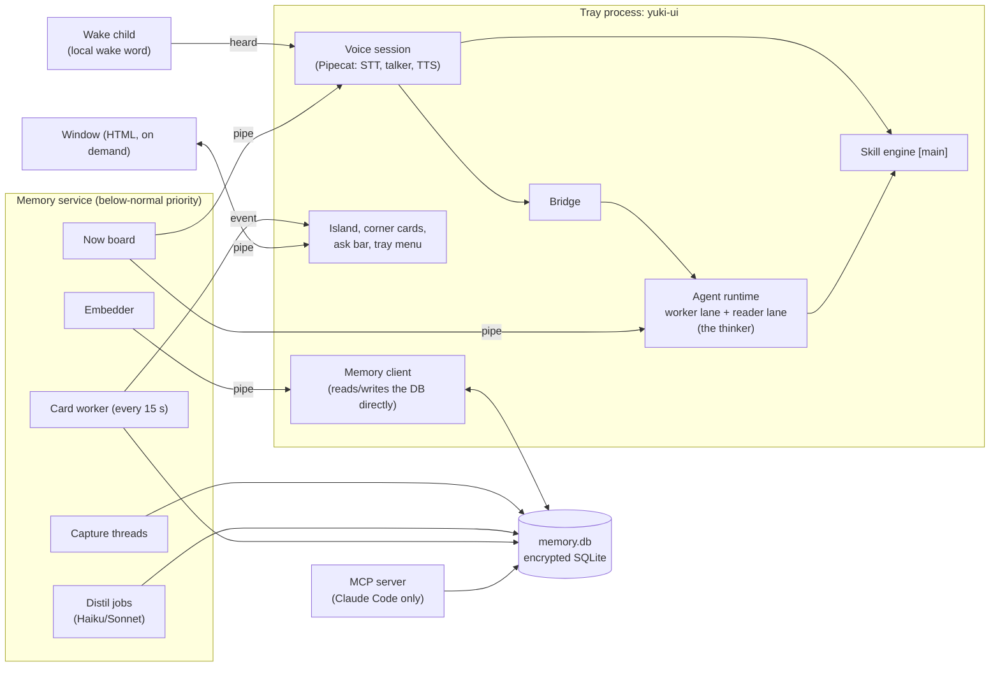
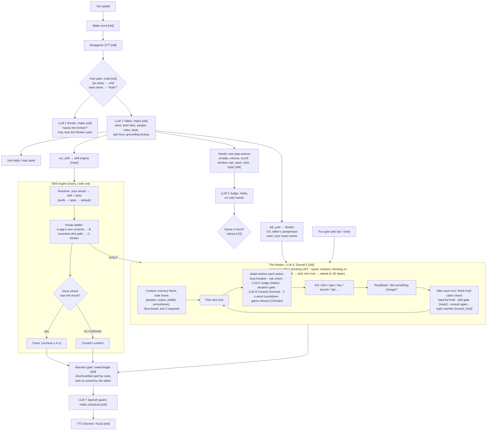
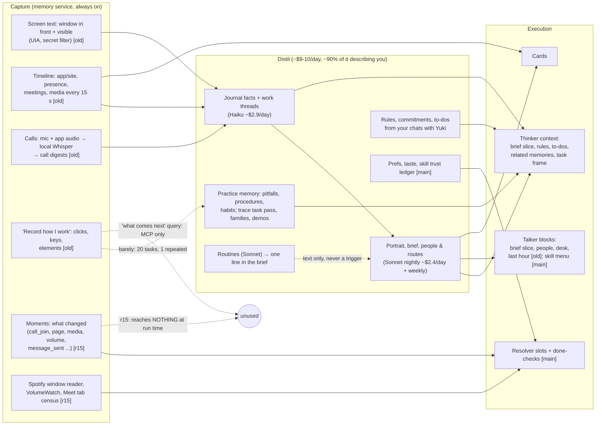
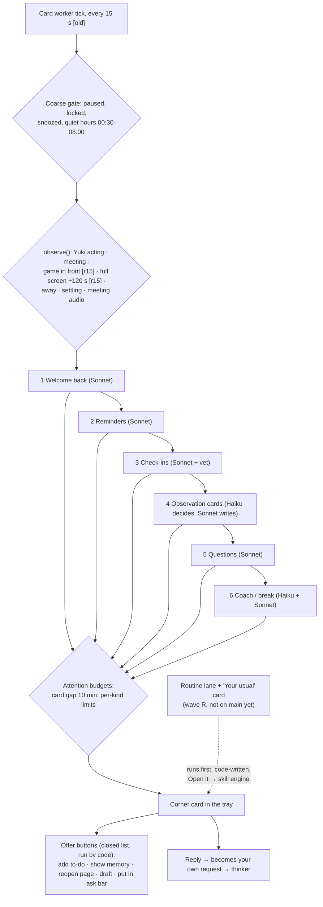
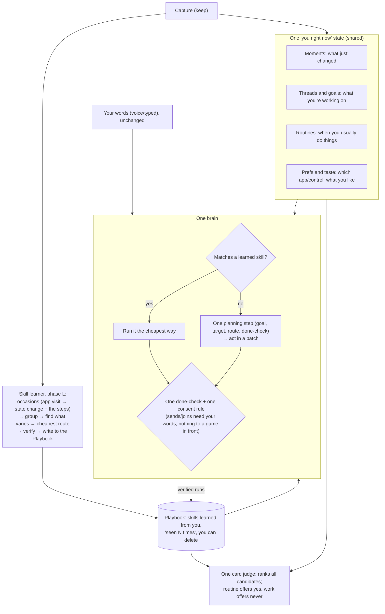

# Yuki architecture as it is now (10 Oct 2026)

Mapped from the code on `main` (a800748) by three read-only readers. Tags:
- **[r15]**: wave F, installed on the PC;
- **[main]**: wave S, merged but **not released** (held for the skill learner);
- **[old]**: unchanged from before 9 Oct, and installed.

The target shape after the course correction is in section 5.

---

## 1. The processes

---

## 2. The brain: how a request becomes actions

Count on the spoken path: **7+ distinct model roles**. Side calls (progress answers, "want the rest?", read-only helpers) add 3 more. Between your words and an action there are **~11 gates**, and about **11 correctors** after each thinker turn. Only requests that match one of the 7 skills take the new engine path [main]. Everything else is the old reactive thinker.

---

## 3. Capture → memory → what actually feeds execution

What this shows:
- **Capture is rich.** Most of the spend turns it into a *description* of you: the journal, the portrait and the brief. That description reaches the thinker and talker only as background text.
- **"How you do things"** (the click trace, practice memory) reaches execution only as advisory notes. Before wave S they were used about 1% of the time. On `main`, practice memory no longer reaches the talker at all.
- **"What changed"** (moments, wave F) feeds only the new engine's done-checks and resolver [main]. In the installed r15 it reaches nothing yet.
- **The missing arrow:** nothing turns what you repeatedly do into a skill. Seven skills were hand-written instead, which is why release 16 is held for the **skill learner** (phase L).

---

## 4. Proactive cards

The first producer that writes a card wins the tick. **Nothing ranks the candidates against each other.** Each producer builds its own picture of you from the DB.

---

## 5. Where this is going (the agreed course correction)

What goes away in that shape:
- the judge, consult, situation gate, claim holds and reply rewriter (replaced by the one done-check and one consent rule);
- the 7 separate card producers (replaced by one judge);
- the advisory "pitfalls" text;
- the hand-written habit skills (replaced by learned ones);
- the old trace learners, once the skill learner replaces them.

The aim is well under today's ~243k lines.
